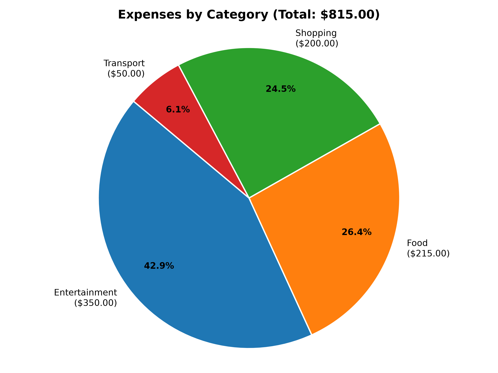

# se-expense-tracker

Software Engineering Assignment 1

### Installation
Install required dependencies:
```bash
pip install -r requirements.txt
```

### 2. Visualization Module (Member B)
Generate an interactive category donut chart and terminal expense summary from `expenses.csv`:
```bash
python visualize.py
```

**Optional Arguments & Interactive Features:**
- **Filter by month (`YYYY-MM`)**: `python visualize.py --month 2026-11`
- **Select initial color theme (`modern`, `morandi`, `dark`)**: `python visualize.py --theme dark`
- **Custom output filename**: `python visualize.py --output custom_chart.png`
- **Interactive Controls**: Use the buttons at the bottom of the chart window to switch themes live (`Modern` / `Morandi` / `Dark Mode`) or click `Save PNG` to export a clean chart image.

### Sample Output
